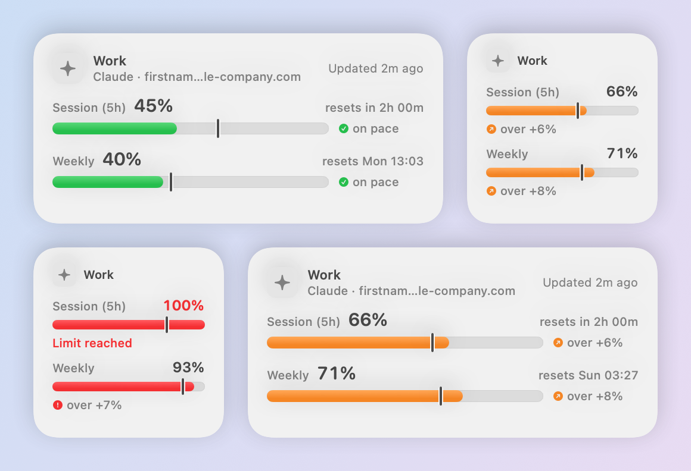
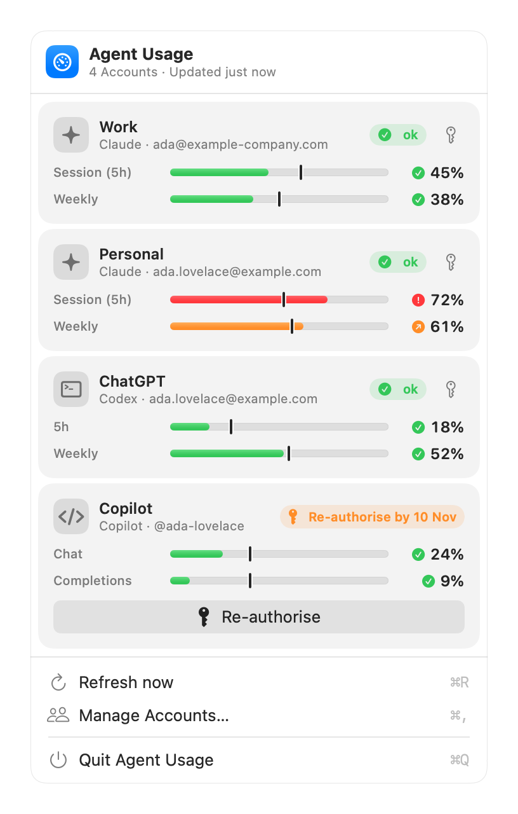
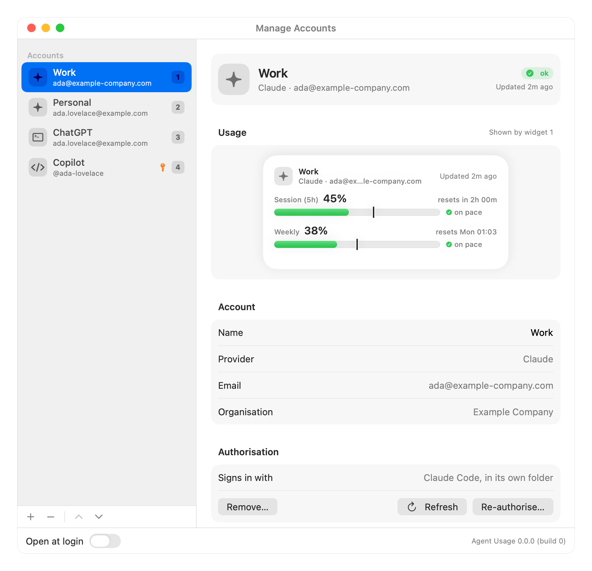
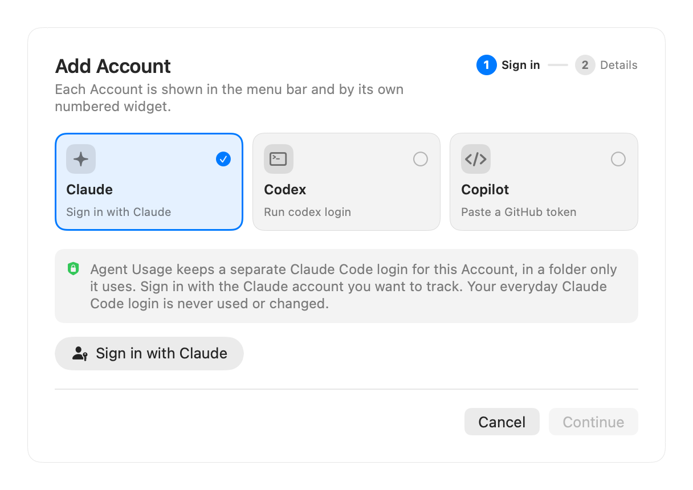
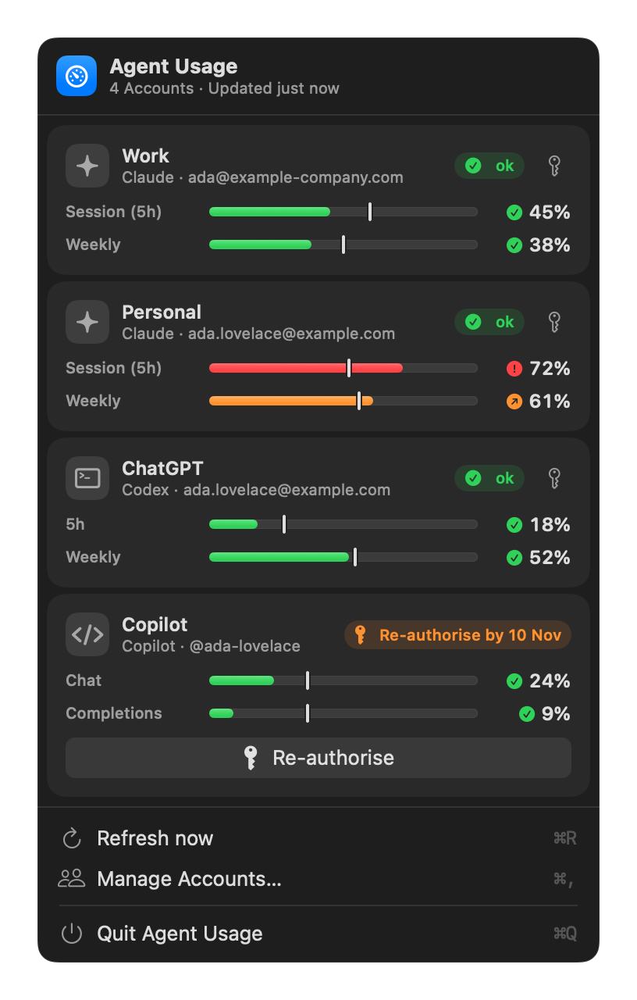
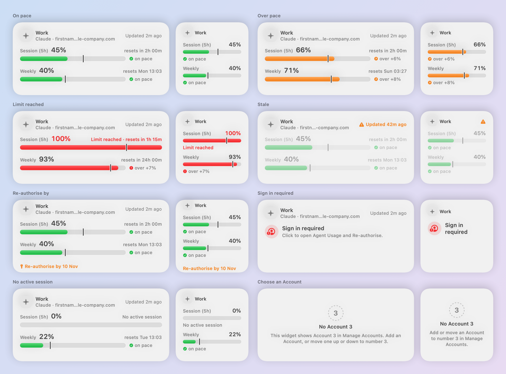

# agent-usage-widget

**Agent Usage** is a macOS desktop widget and menu-bar app that shows your AI subscription usage limits, for one or more named Accounts at Claude, ChatGPT/Codex and GitHub Copilot. A **Pace marker** on each bar shows whether you're using your allowance faster than its window allows.

<picture>
  <source media="(prefers-color-scheme: dark)" srcset="docs/images/widgets-dark.png">
  
</picture>

> **Status:** Claude, Codex and Copilot are built and checked on the Owner's Mac ([`prototypes/`](prototypes/), PRD §11). Gemini CLI is deferred because the Owner's account can't sign in (ADR-0007).

## Website

The project website, **[adrianeyre.github.io/agent-usage-widget](https://adrianeyre.github.io/agent-usage-widget/)**, shows what Agent Usage does, with live product demos. Its source is [`site/`](site/); the **Pages** workflow publishes it on each push to `main` that changes it ([details](docs/guide/releasing.md#the-website)).

## Quick start

```bash
scripts/install.sh            # downloads the latest release with gh, checks it and installs it
```

Then click the **gauge** icon in the menu bar → **Manage Accounts…** → **+**, sign in, and add **Agent Usage: Account 1** from the widget gallery (right-click the desktop → **Edit Widgets…**). Releases are self-signed, so always install with the script: a browser download is blocked by Gatekeeper. See [Installing](docs/guide/installing.md) and [Adding Accounts](docs/guide/adding-accounts.md).

## Features

- **Pace, not just percentages.** Each bar has a marker at where you'd be if you spread the allowance evenly: green on pace, amber slightly over, red well over or above 90%, always with a symbol and words too. [How to read it](docs/guide/reading-usage.md)
- **Several Providers and Accounts.** Any number of named Accounts at Claude, Codex and Copilot, several at one Provider if you like. Figures are only ever the Provider's own; nothing is estimated. [Providers](docs/guide/providers.md)
- **One Account per widget.** The gallery offers **Account 1** to **Account 6**, in small and medium sizes; the order in Manage Accounts is the widget number.
- **A menu bar at a glance.** Every Account's bars and status, with **Re-authorise**, **Refresh now** (⌘R) and **Manage Accounts…** (⌘,).
- **Private by design.** The widget never touches credentials or the network, and the app never uses or changes your everyday Claude Code or Codex login. [How it works](docs/guide/how-it-works.md)

## Screenshots

| | |
|---|---|
| **The menu-bar dropdown**<br>[](docs/images/menu.png) | **Manage Accounts**<br>[](docs/images/manage-accounts.png) |
| **Add Account**<br>[](docs/images/add-account.png) | **Dark mode**<br>[](docs/images/menu-dark.png) |

**Every widget state**, from on pace to Sign in required:

[](docs/images/widget-states.png)

Every screenshot, light and dark, is in [Screenshots](docs/guide/screenshots.md). `scripts/screenshots.sh` renders them again from the app's real views.

## The guide

| Guide | What it covers |
|-------|----------------|
| [Installing](docs/guide/installing.md) | Requirements, `scripts/install.sh`, updating, first launch and uninstalling. |
| [Adding and managing Accounts](docs/guide/adding-accounts.md) | Signing Claude, Codex and Copilot Accounts in, the numbered widgets, re-ordering, re-authorising and removing. |
| [Reading the widgets](docs/guide/reading-usage.md) | Bars, the Pace marker and its maths, the colours and every state. |
| [Providers](docs/guide/providers.md) | What's supported, where each Provider's figures come from, and why others aren't. |
| [How it works](docs/guide/how-it-works.md) | The host app and the widget, where everything is kept, Authorisations and the refresh interval. |
| [Design](docs/guide/design.md) | The design system: principles, tokens, colour roles, shared parts and accessibility. |
| [Developing](docs/guide/development.md) | Setup, every command, the project layout, Fixture Accounts and the screenshots. |
| [CI, releases and the website](docs/guide/releasing.md) | The workflows, semantic-release, the signing secrets and GitHub Pages. |
| [Troubleshooting](docs/guide/troubleshooting.md) | Common problems, debugging on macOS, and the widget, signing and Provider gotchas. |

## Documentation

| Path | What it is |
|------|------------|
| [`GLOSSARY.md`](GLOSSARY.md) | What we mean by Provider, Account, Limit, Authorisation, Pace marker, …; use its terms exactly |
| [`docs/product-requirements-document/`](docs/product-requirements-document/agent-usage-widget.md) | Requirements, Providers, layout, edge cases and acceptance criteria |
| [`docs/adr/`](docs/adr/) | Decisions that must not be quietly reversed, from borrowing Claude Code logins (0001) to dedicated Claude Code folders (0011) |
| [`docs/guide/`](docs/guide/README.md) | How Agent Usage works, part by part |
| `docs/images/` | The screenshots (`scripts/screenshots.sh`) |
| [`docs/agents/`](docs/agents/) | Configuration for the agent skills (issue tracker, triage labels, domain docs) |

## Contributing

Commits follow [Conventional Commits](https://www.conventionalcommits.org): `fix:` makes a patch release, `feat:` a minor and `BREAKING CHANGE` a major. CI builds and tests every pull request, and every push to `main` releases. See [Developing](docs/guide/development.md) and [CI, releases and the website](docs/guide/releasing.md).
