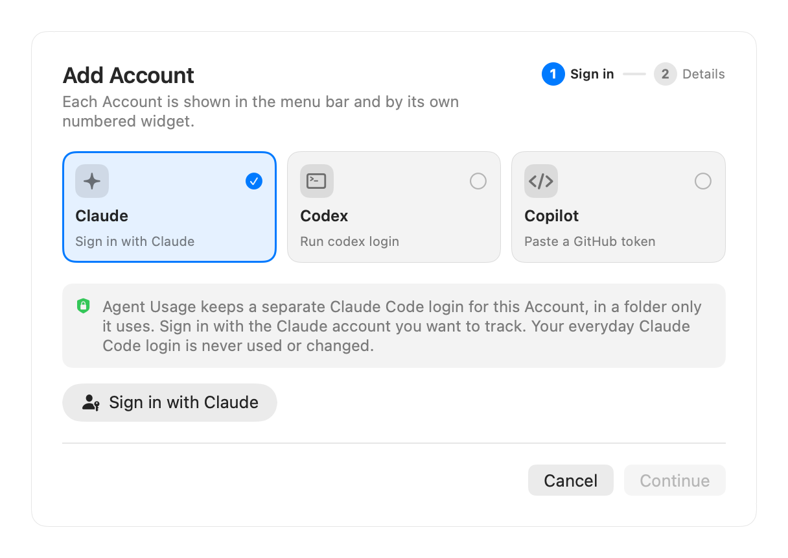
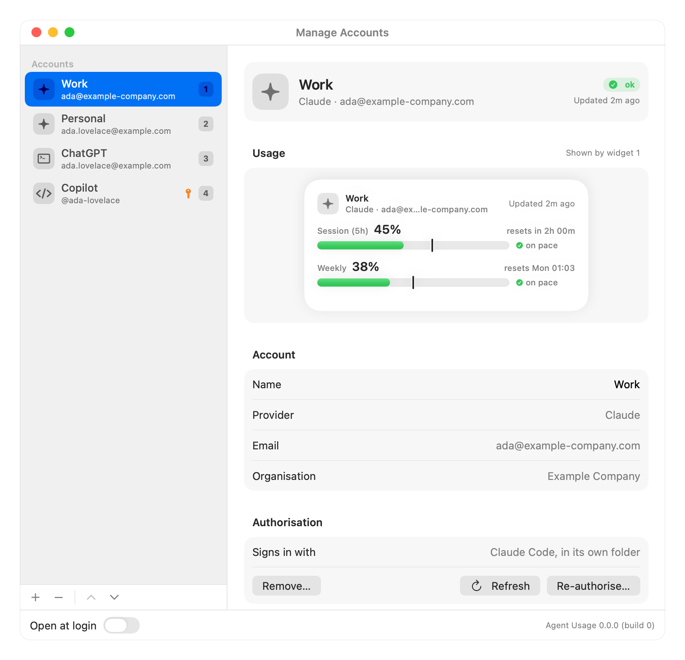
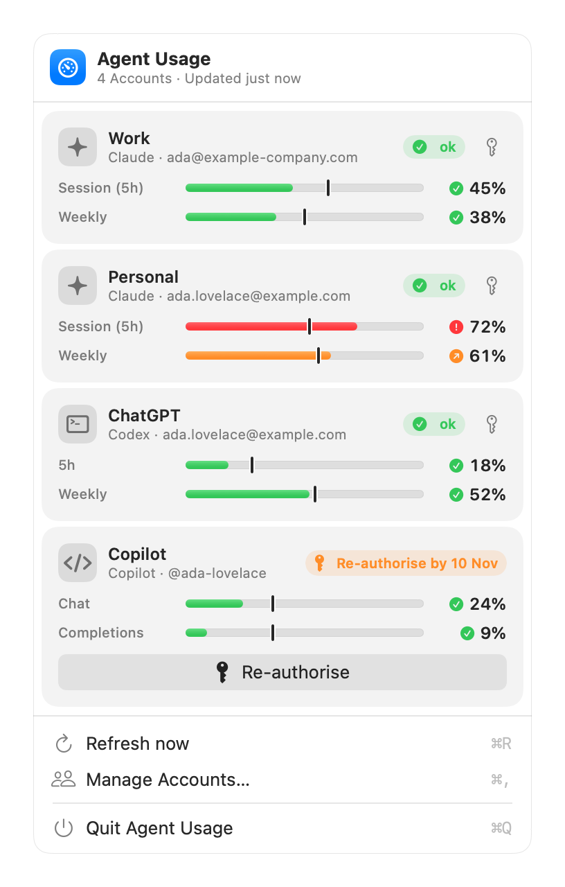

# Adding and managing Accounts

An **Account** is one sign-in at one Provider, with a name you choose (e.g. "Work", "Personal"). You can add any number of Accounts, at any mix of Providers, including several at the same Provider.

## Add an Account

Open the menu-bar app (the **gauge** icon) → **Manage Accounts…** → **+** (or **Add Account…** when there are none yet). Pick a Provider, sign in, then check the email and name and click **Add Account**.

### Claude

Click **Sign in with Claude** and approve in the browser.

- The login goes into a Claude Code folder that only this Account uses (ADR-0011). Your own `~/.claude` is never read or changed.
- Add as many Claude Accounts as you like.
- `claude auth login` finishes by itself if the browser is already signed in to claude.ai, so it signs in as whoever the browser is signed in as. **To add a different account**, sign out of claude.ai in the browser first, or open the sign-in link (shown under **Browser didn't open?**) in a private window.
- If Claude Code asks for a code, paste it into the field that appears and click **Send**.

### Codex (ChatGPT plans)

Click **Run codex login** and sign in in the browser.

- The login goes into a Codex home that only this Account uses (ADR-0005). Your own `~/.codex` is never used.
- The plan or workspace (e.g. *ChatGPT Plus*) is read from the login, so two Accounts with one email stay apart.

### Copilot

Click **Open GitHub's new token page** and create a **fine-grained personal access token**:

- **Repository access:** *Public repositories*
- **Account permissions:** **Plan: Read-only**, and nothing else
- **Expiration:** up to a year, e.g. *Custom → 366 days*

Paste it in (it starts with `github_pat_`), then tick **The token expires** and enter the same date, or untick it for *No expiration*. GitHub only reports the expiry for tokens that expire, which is why you enter it (U3). Agent Usage warns you 7 days before.

*Plan: read* can't read your private emails, so a Copilot Account shows `@username` and your public profile email.

### Fixture (Debug builds only)

Debug builds can add **Fixture** Accounts, which return canned Limits and need no Authorisation. Pick a scenario (normal, over pace, limit reached, no active session, sign in required, or offline, where every fetch fails) to see each state. They're compiled out of Release builds, and CI checks for that.

## Show an Account in a widget

Right-click the **desktop** → **Edit Widgets…** → search "Agent Usage", then add **Agent Usage: Account 1**, **2**, … in the small or medium size.

Each widget shows the Account **at that number** in Manage Accounts (ADR-0009): the number badge beside each Account in the sidebar is the widget that shows it. Only the first six Accounts have a widget. There's no Edit Widget picker; see [Troubleshooting](troubleshooting.md#widgets) for why.

## Manage Accounts

| To | Do |
|----|----|
| See an Account's usage | Select it. **Usage** shows the medium widget exactly as it's drawn on the desktop, and which widget number shows it. |
| Rename it | Edit **Name**, then press Return or click **Rename**. Names must be unique. |
| Re-order it (and so change its widget) | Drag it, use **⌥⌘↑** / **⌥⌘↓**, the ▲ ▼ buttons, or right-click → **Move Up** / **Move Down**. |
| Refresh just this Account | **Refresh** under **Authorisation**. |
| Re-authorise it | **Re-authorise…** (prominent when the Account needs it), or the key button on its card in the menu. Sign in as the same account. |
| Remove it | **Remove…** or **−**. This deletes Agent Usage's copy of its Authorisation and its Snapshot, signs its private Claude Code or Codex folder out and deletes it. Your own logins aren't touched. |

Adding the same account twice is refused (A1), with a button to show the existing one.

## The menu-bar dropdown

One card per Account, in Manage Accounts order: its Provider, name, email, status and each Limit's bar and % used. Click a card to open it in Manage Accounts. Below them:

| Item | Shortcut |
|------|----------|
| **Refresh now** | ⌘R |
| **Manage Accounts…** | ⌘, |
| **Quit Agent Usage** | ⌘Q |
