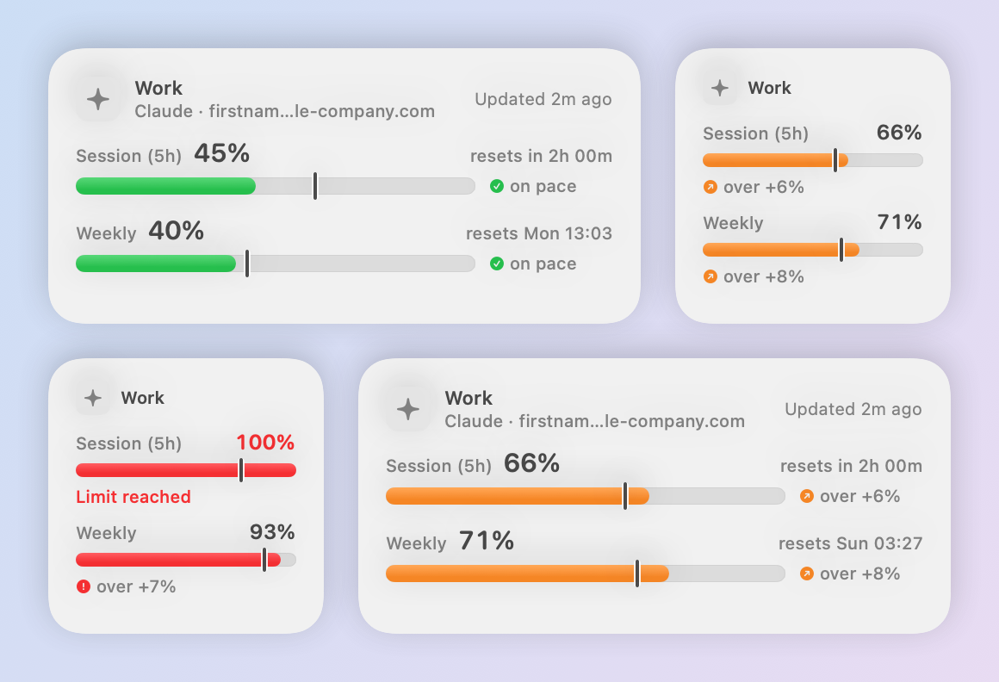
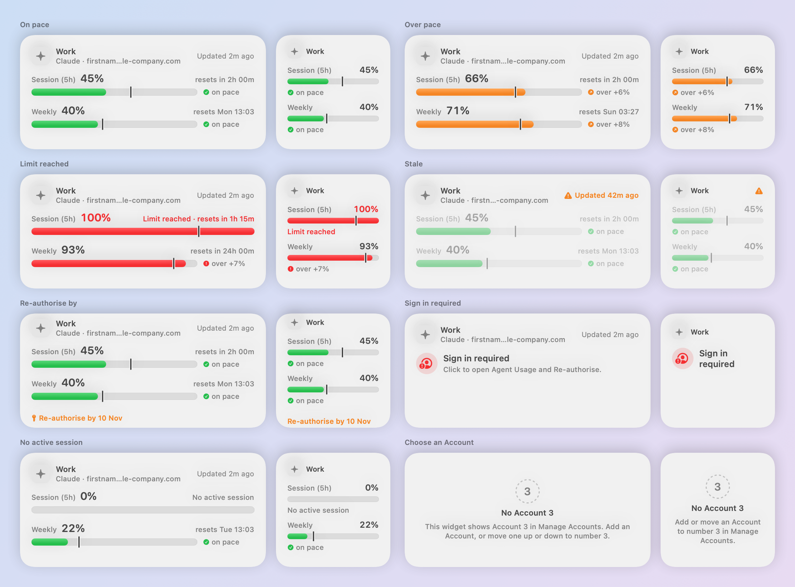
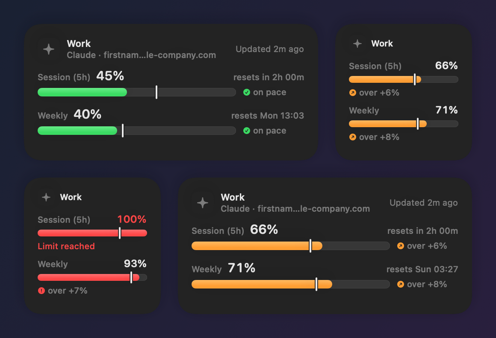

# Reading the widgets

Every Limit is a bar with a **Pace marker**: a thin line at where your usage would be if you spread the allowance evenly over its Window. Fill left of the marker means you're on pace; fill past it means you're using the allowance faster than the Window allows.



## A bar, piece by piece

```
 Session (5h)  45%                      resets in 2h 00m
 [███████████████░░░░░│░░░░░░░░░░░░░░]  ✓ on pace
                      ↑ Pace marker at 60%
```

| Part | What it shows |
|------|---------------|
| **Name** | The Limit, as the Provider names it: `Session (5h)`, `Weekly`, `5h`, `Chat`, … |
| **Figure** | The percentage of the Limit used (F3). `—` when the Provider didn't send one: Agent Usage never makes a figure up (R6). |
| **Reset** | `resets in 2h 14m` within a day, otherwise `resets Mon 09:00` (F4, medium widget only). |
| **Fill** | Used, from 0 to 100% (F2), coloured by pace. |
| **Pace marker** | Expected usage now: `elapsed time ÷ Window length`, where elapsed = `Window length − time until reset` (P1–P4). It moves on every timeline entry, even between fetches (P5, R2). |
| **Pace label** | `on pace`, or `over +12%`: how many percentage points past the marker (C5). |

**Worked example:** a session reset is 2h 00m away, so 3h of the 5h Window has passed and the marker sits at 60%. At 45% used you're on pace; at 75% you're over by 15.

## Colours

Colour is never the only signal: each band has its own symbol and the pace label says it in words.

| Fill | Symbol | When |
|------|--------|------|
| Green | ✓ | On pace: used ≤ marker (C1). |
| Amber | ↗ | Slightly over: used ≤ marker + 10 percentage points (C2). |
| Red | ! | Well over: used > marker + 10 pp, **or** used ≥ 90% (C3). |
| Accent | ◌ | No Window length is known, so there's no marker and no pace colouring (P0). |

The 10-point threshold is one constant, `Pace.overPaceThreshold` (C4).

## Every state



| State | What you see |
|-------|--------------|
| **On pace / Over pace** | Bars, figures, reset times and pace labels. |
| **Limit reached** | A full red bar, the figure in red and `Limit reached · resets in …`. |
| **Stale** | Dimmed bars and an orange ⚠ `Updated 42m ago`: the last good fetch is over 30 minutes old, or a reset time has passed (R4). The markers keep moving. |
| **Re-authorise by** | A key and `Re-authorise by 12 Nov`, from 7 days before a known expiry (U3). |
| **Sign in required** | No figures at all, never zeros (R5). Click the widget to open Agent Usage and Re-authorise. |
| **No active session** | The session bar is empty with no marker, and says `No active session` (P6). |
| **No Account *n*** | The widget's number has no Account. Add one, or move one to that number. |

The small widget shows the Provider glyph, the Account name and up to two bars, with no email and no reset times. Both sizes support light and dark mode.



Clicking a widget opens Manage Accounts with its Account selected (U5).
