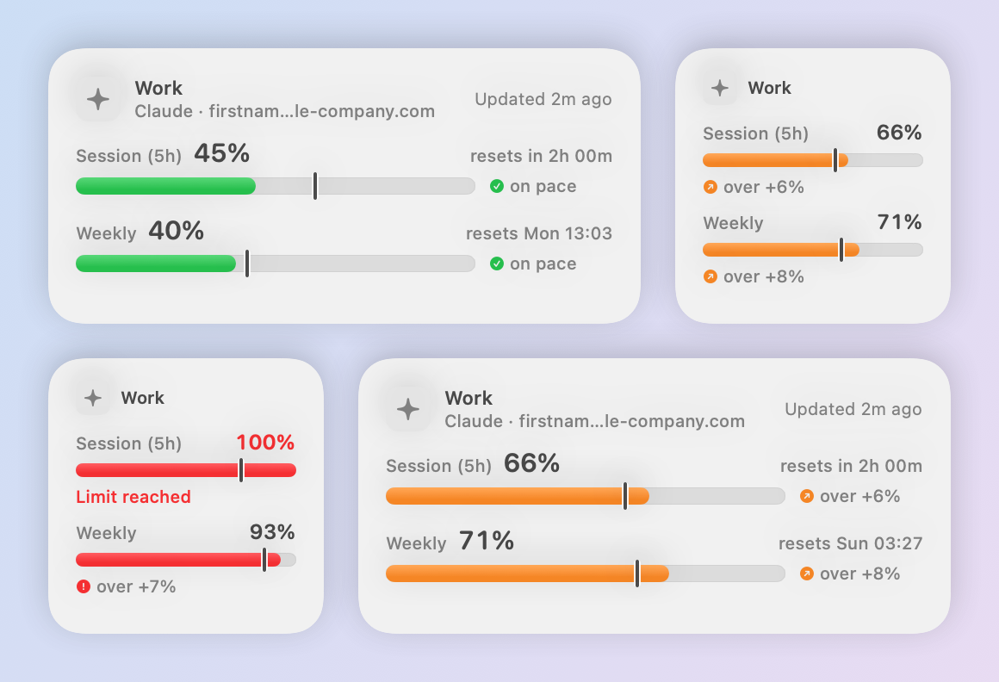
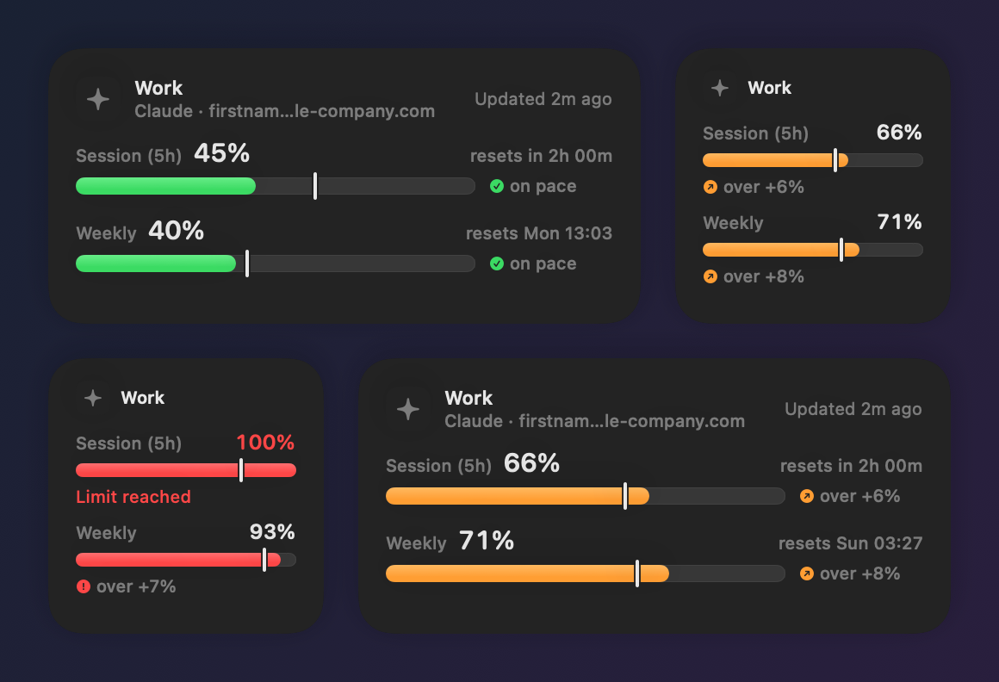
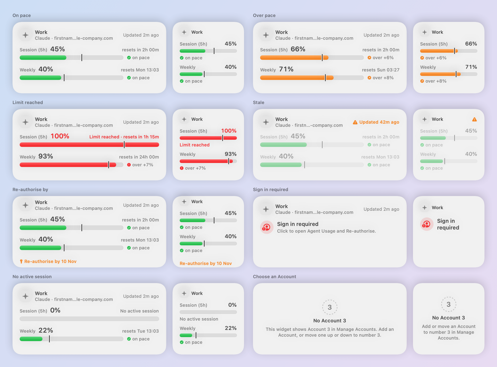
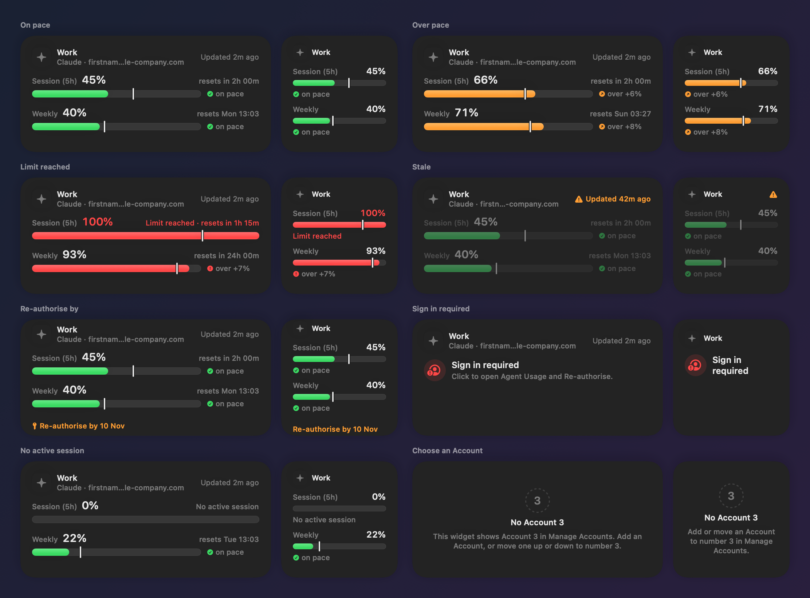
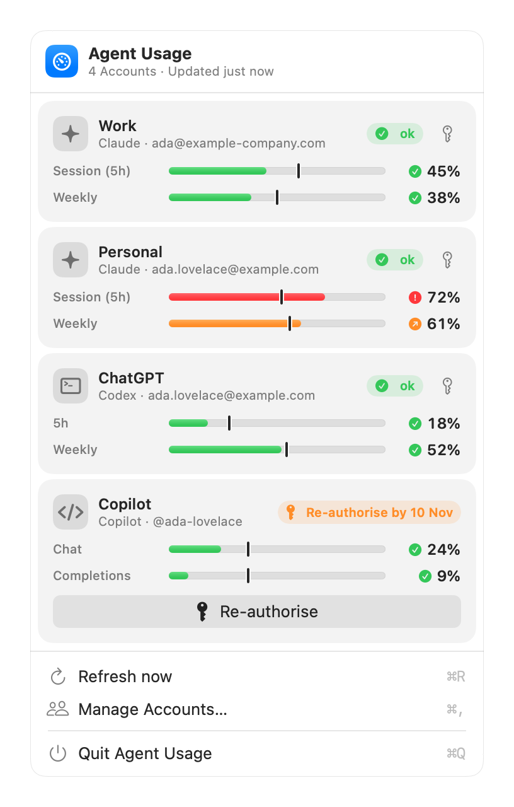
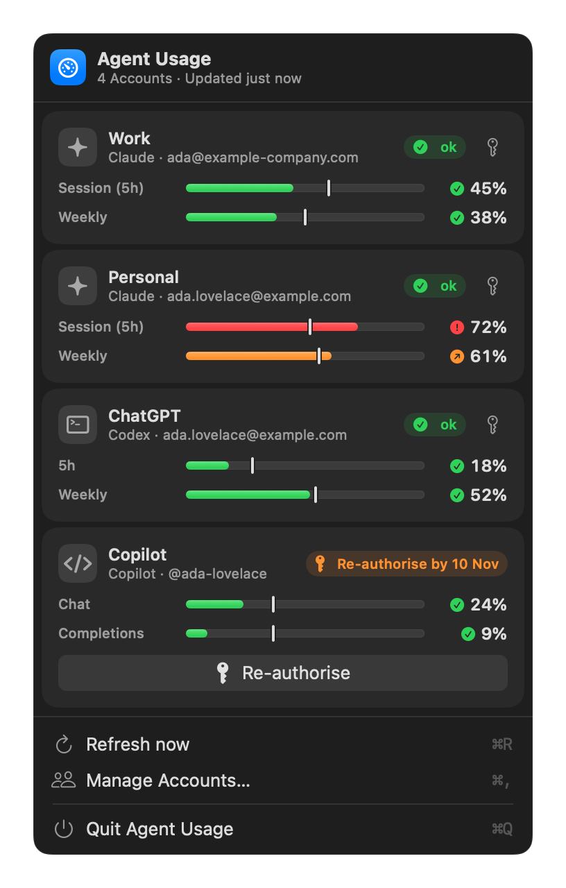
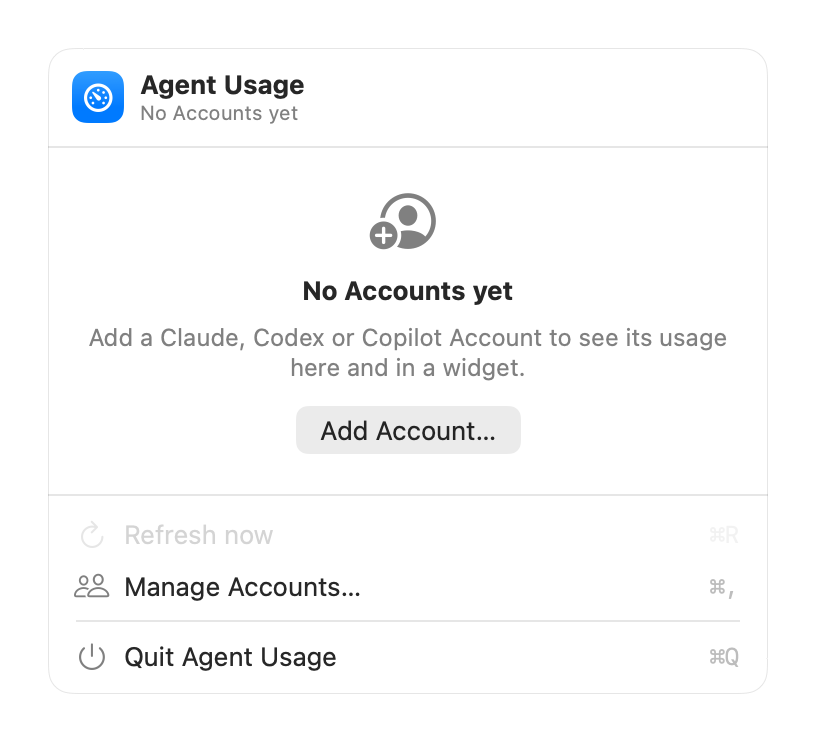
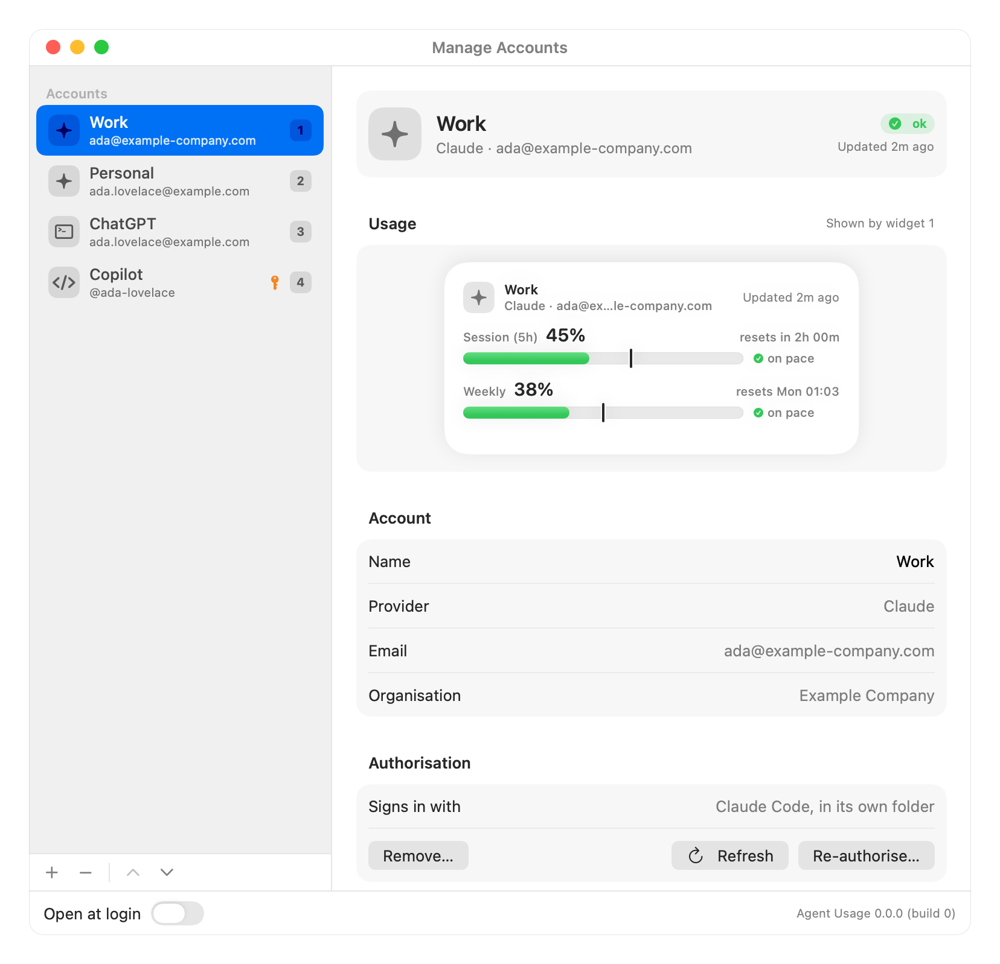
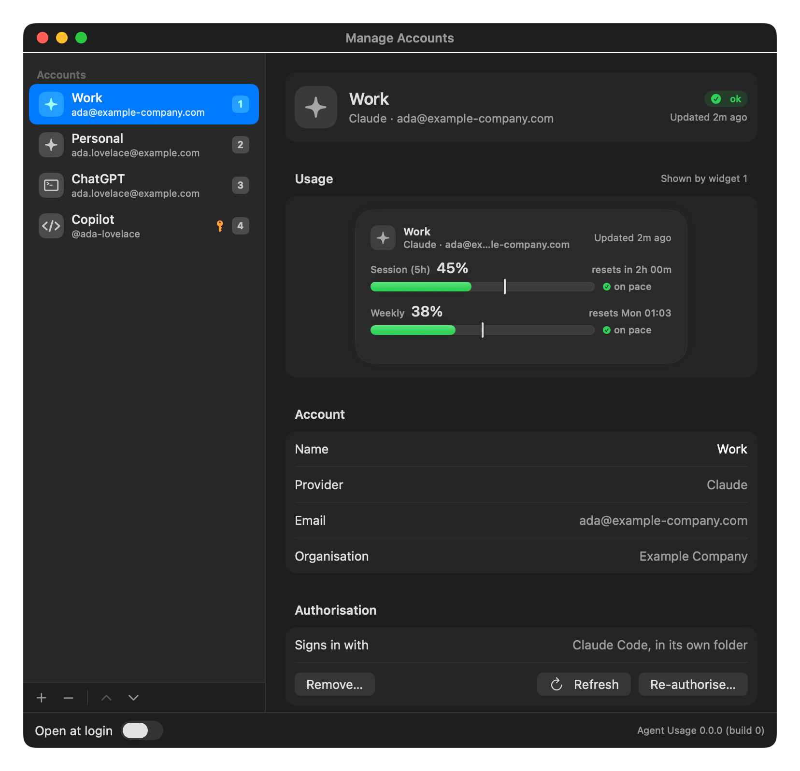
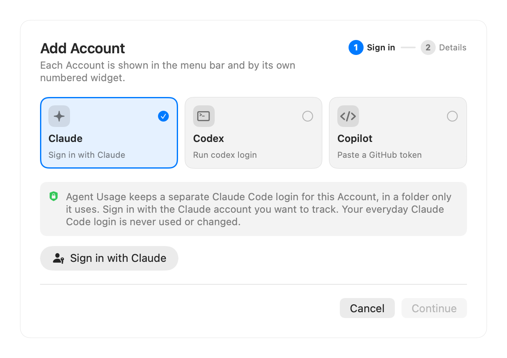

# Screenshots

Every screenshot is rendered from the app's real SwiftUI views with sample Accounts by `scripts/screenshots.sh` (see [Development](development.md#screenshots)). The names and figures are sample data.

## The widgets

Medium and small, on pace, over pace and at a reached Limit.

| Light | Dark |
|-------|------|
|  |  |

## Every widget state

On pace, over pace, Limit reached, Stale, Re-authorise by, Sign in required, No active session and No Account *n* (see [Reading the widgets](reading-usage.md#every-state)).

## The menu-bar dropdown

A card per Account with its status and bars; Copilot is within 7 days of its token's expiry, so its Re-authorise button is prominent.

| Light | Dark | No Accounts yet |
|-------|------|-----------------|
|  |  |  |

## Manage Accounts

The sidebar shows each Account's widget number; the detail shows the selected Account's widget as it's drawn on the desktop.

## Add Account

